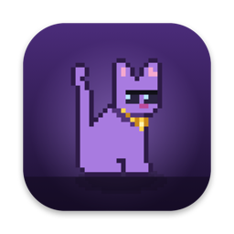
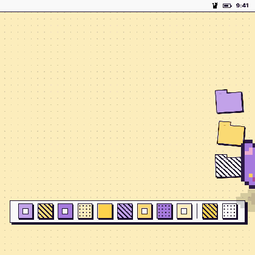
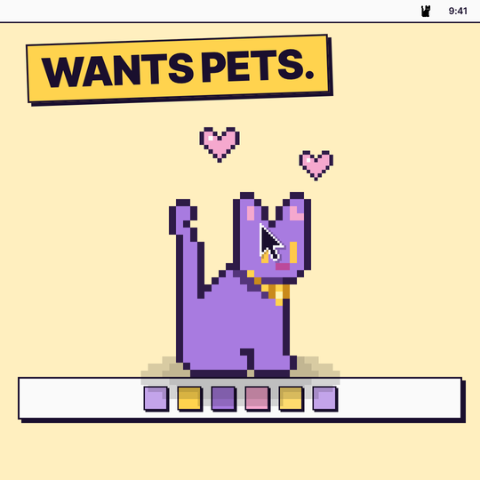
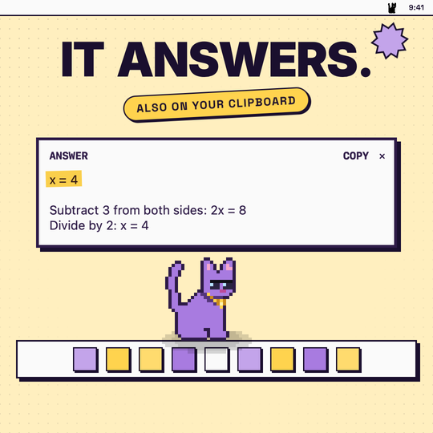
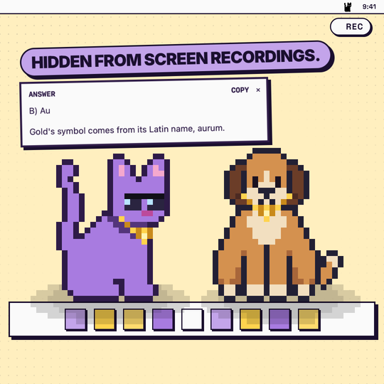
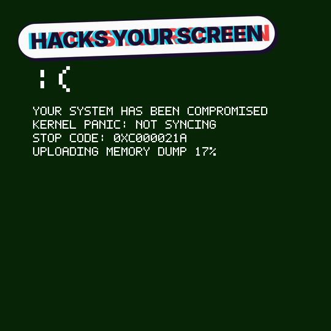

<p align="center">
  
</p>

<h1 align="center">Screen Cat</h1>

<p align="center">
  <b>A pixel pet that lives on your Mac screen, and answers what you copy.</b><br>
  Pick a cat or a dog. It walks, naps, chases a ball and wants pets.<br>
  Copy a question or take a screenshot, and it walks out holding the answer.
</p>

<p align="center">
  
  
  
</p>

<p align="center">
  
</p>

---

## What it does

<table>
  <tr>
    <td width="50%"></td>
    <td width="50%"></td>
  </tr>
  <tr>
    <td><b>A real little roommate.</b> It walks along the bottom and the sides of your screen, naps with z's, chases its ball, begs for food, and asks you to play. Rest your pointer on it and it gets petted.</td>
    <td><b>It answers what you copy.</b> Turn on LLM mode, copy a question twice (Cmd+C Cmd+C) or take a screenshot, and the pet walks out holding the answer: maths solved with the steps, facts checked, code explained, words defined. The answer is also put on your clipboard, ready to paste.</td>
  </tr>
  <tr>
    <td></td>
    <td></td>
  </tr>
  <tr>
    <td><b>Cat or dog.</b> Switch from the menu bar at any time, even mid-walk. Both wear a gold chain, and sometimes shades.</td>
    <td><b>It "hacks" your screen.</b> Crawler mode zaps your windows with fake cracks and glitches. Zero Day is a three-minute fake hack of the whole screen, with sound. It is all paint: your apps are never touched.</td>
  </tr>
</table>

And a few quieter things:

- **Private by default.** The pet and its answer card stay out of screenshots, screen recordings and screen sharing, unless you tick **Show in screenshots & recordings**.
- **Stays out of the way.** It hides while a video player (VLC, IINA, QuickTime, TV, Netflix, Plex, Infuse) is in front.
- **Idle takeover.** Leave the Mac alone for half an hour and the pet grows and turns the screen into a glitch show. The first touch ends it and puts you back in your app.
- **Stepped out.** One click keeps your Mac awake and the screen on, like `caffeinate`.
- **Click-through.** The pet is drawn on a see-through layer. Your clicks always reach the app underneath.

## Install

1. Download `ScreenCat-mac-<version>.zip` from [Releases](../../releases) and unzip it.
2. Drag **ScreenCat** into your **Applications** folder.
3. Open it the first time with **right-click > Open**, then **Open** again. The app is not notarized by Apple yet, so a plain double-click is blocked once. (Or open it, then go to **System Settings > Privacy & Security** and click **Open Anyway**.)
4. Look at the **top right of your menu bar** for a little cat silhouette. Everything lives in that menu.

To start it every time you log in, tick **Open at login** in the menu.

Needs macOS 12 or later, Apple silicon or Intel.

## LLM mode

Open the menu and go to **LLM mode > Answer what I copy or screenshot**. From then on:

- **Copy any text twice in a row** (Cmd+C Cmd+C, within a second): a question, an equation, a claim, a word, an error message. The pet walks on with a card: what you asked, dots while it thinks, then the answer, its first line in bold. One copy is just a copy, so everyday copying never asks. A copied picture still asks at once. To answer every copy of text instead, untick **LLM mode > Only when I copy twice (⌘C ⌘C)**.
- **Take a screenshot** (Cmd+Shift+4) and it answers what is in it. Add Control (Cmd+Ctrl+Shift+4) to copy the screenshot instead, which it picks up instantly.
- **Ask a follow-up** in the field under the answer: a question about it, or a request like "shorter", "explain step 2" or "in French". Press Enter and the answer comes back on the same card, with the conversation so far. A new copy or screenshot starts a fresh conversation.
- **Ask about what I copied now** asks once, with or without the mode on.
- **Show answer box** off: no pet, no card, the answer just lands on your clipboard. The menu bar icon shows 💭 while it thinks and ✅ when the answer is ready to paste.

**Where answers come from.** Either:

- **Your own Anthropic API key.** Choose **LLM mode > Set API key…** and paste a key from [console.anthropic.com](https://console.anthropic.com). It is kept in your Mac's keychain. You pay Anthropic per answer, usually a few cents at most.
- **Claude Code.** No key? If [Claude Code](https://claude.com/claude-code) is installed and logged in, Screen Cat uses it.

**What is never sent:** text you copy only once (while **Only when I copy twice** is on, the default), anything a password manager marks as private, files copied in Finder, whatever was already on the clipboard when you turned the mode on, and text copied out of the pet's own card. With **Only when I copy twice** off, everything else you copy while LLM mode is on is sent to Anthropic to be answered, except the same text twice in a row.

## The menu

| Item | What it does |
| --- | --- |
| *Top line* | What the pet is doing, or when it comes back. |
| **Pause** | Send the pet away until you resume. |
| **Pet: Cat / Dog** | Switch pets. |
| **Mode: Normal / Crawler** | Normal routines, or window-zapping hacker visits. |
| **Play now** | Walk, nap, ball, beg, ask to play, break some apps, crawl, Zero Day. |
| **LLM mode** | Turn answering on or off, ask only on a double copy or on every copy, show or hide the answer box, copy answers, set your API key. |
| **Stepped out** | Keep the Mac awake. A ☕ shows by the icon. |
| **Show in screenshots & recordings** | Let captures see the pet and its card. |
| **Open at login** | Start Screen Cat when you log in. |
| **Open playground** | A window with its own pet and pretend apps to play in. |
| **Activity log / Settings** | Open the local log, edit or reload settings. |

## Settings

Everything is in `~/.screencat.json`, created on first launch. Edit it with **Settings > Edit settings file…**, then **Reload settings**. A few you might want:

| Key | Default | Meaning |
| --- | --- | --- |
| `pet` | `cat` | `cat` or `dog`. |
| `sizeDivisor` | `24` | Bigger number, smaller pet. |
| `furColor` | `#A87BE0` | The cat's coat colour (the dog keeps its own). |
| `minGapSeconds` / `maxGapSeconds` | `3` / `15` | Quiet time between visits. |
| `blockedApps` | video players | Apps that make the pet hide while they are in front. |
| `idleCrawlSeconds` | `1800` | Idle time before the glitch takeover. |
| `llmModel` / `llmEffort` | `claude-opus-5-5` / `medium` | Which Claude model answers, and how hard it thinks. |
| `activityLog` | `true` | Keep the local activity log. |

The full list, with every flag for testing, is in [mac/README.md](mac/README.md).

## FAQ

**I opened it and nothing happened.** It has no window and no Dock icon. Look for the cat silhouette at the top right of the menu bar. The pet itself comes out within about 20 seconds.

**The pet disappeared.** A video player is probably in front, or the menu says **Paused**. The top line of the menu always says why.

**My Mac will not sleep.** **Stepped out** is on (there is a ☕ next to the icon). Untick it, or quit Screen Cat.

**LLM mode says it cannot find `claude`.** Set an API key with **LLM mode > Set API key…**, or install Claude Code.

**What is in the activity log?** A plain-text diary in `~/Library/Logs/ScreenCat`: which app was in front and for how long, sleep and wake, Bluetooth on or off, and what the pet did. It never leaves your Mac. Set `activityLog` to `false` to turn it off.

## Build from source

```bash
cd mac
./build.sh
open ScreenCat.app
```

`./release.sh` builds and zips the app into `mac/dist/` for a GitHub release and prints its SHA-256. The dog art is generated by `swift mac/Tools/make_dog.swift`, and `--app-icon` redraws the app icon.

| Platform | Folder | State |
| --- | --- | --- |
| macOS | [`mac/`](mac/) | Working. Native Swift and AppKit, no dependencies. |
| Android | [`android/`](android/) | Early port on the `feat/android-port` branch. |
| Windows | [`windows/`](windows/) | Early port on the `feat/windows-port` branch. |

## Credits

- **Cat art:** "Cat Pack" by Glem / octopusINKUS, [octopusinkus.itch.io/cat-pack](https://octopusinkus.itch.io/cat-pack), used with the artist's permission. If you want the cat art for something else, get it from the artist.
- **Dog art:** original, made for Screen Cat.
- Made by [Oleanji](https://oleanji.life).
